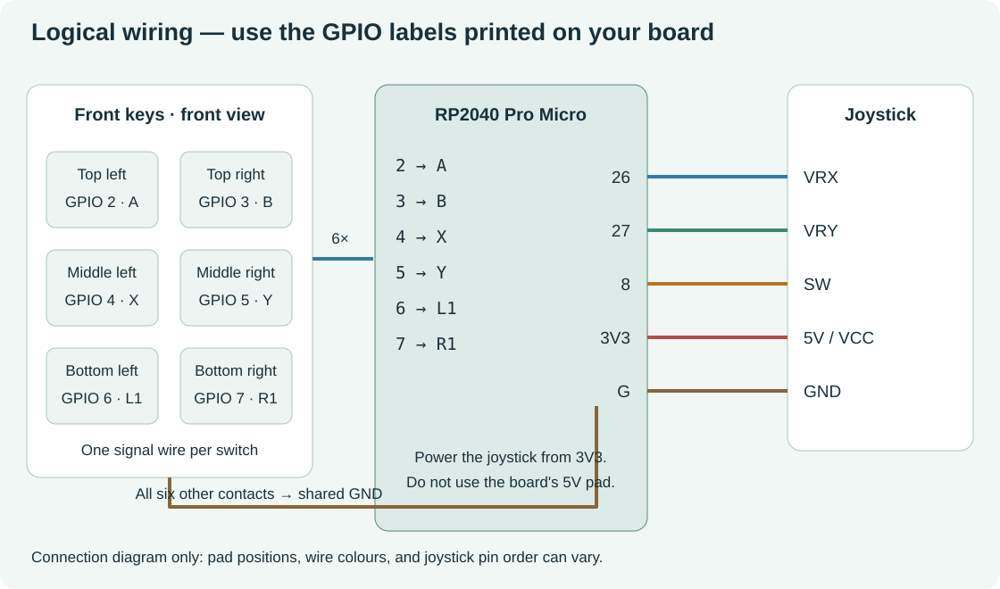

# 6-Key Joystick Pad

Download the **3MF print project** from the corresponding **MakerWorld model page**.

## 1. Parts

| Part | Quantity and specification |
| --- | --- |
| RP2040 Pro Micro USB-C board | 1; nominal 33 × 18 mm PCB; tested board uses Winbond W25Q32 flash |
| HW-504 / KY-023-style joystick | 1; two analog axes + push switch; CAD PCB target **34 × 26 × 1.6 mm** |
| M3 machine screws | **8 × M3 × 10 mm**; 10 mm measured under the head; flat seating underside, not countersunk |
| M3 heat-set brass inserts | **8 × M3 internal thread, OD approximately 4 mm × length 5 mm** |
| MX switches and keycaps | 6 of each |
| Insulated wire and solder | For six key signals, common ground, and five joystick connections |
| USB data cable | 1; USB-C at the controller end; suitable OTG connection for Android |
| PCB fixing | Original printed clip + cable tie up to 5 mm wide, or a small amount of silicone adhesive |
| Tools | Soldering iron, desoldering wick/pump, cutters, screwdriver; multimeter recommended |

**Screw/insert distribution:** front plate **4**, lid-to-body **2**, joystick retaining tabs **2**. Inserts go into **six body posts and two lid posts**. M3 is the internal thread size; the insert outside diameter is approximately **4 mm**. CAD insert bores: Ø4 × 6 mm deep; screw clearance holes: Ø3.4 mm.

**The joystick's stock five-pin header and plastic carrier must be removed to fit this build.** Solder wires directly to its five pads. Do not bend the header or add female jumper housings.

The joystick uses a 34 × 26 mm PCB footprint; the [reference stock module](https://eduino.cafe24.com/product/detail.html?product_no=78) is listed as 40 × 26 × 32 mm overall before modification. Check your module's PCB and component outline.

## 2. Wiring

Use the **GPIO numbers printed on the RP2040**, not physical pin numbers. Key positions below are viewed from the front.

| Key row | Left key | Right key |
| --- | --- | --- |
| Top | GPIO **2** → A | GPIO **3** → B |
| Middle | GPIO **4** → X | GPIO **5** → Y |
| Bottom | GPIO **6** → L1 | GPIO **7** → R1 |

Connect each key's other contact to a shared **GND → G** wire.

| Joystick pad | RP2040 |
| --- | --- |
| GND | G |
| 5V / VCC | **3V3** |
| VRX | **26** |
| VRY | **27** |
| SW / stick click | **8** → L3, HID button 14 |

**Use 3V3 for the joystick, even if its pad is marked 5V. Do not connect it to the RP2040 board's 5V pad.**

## 3. Assembly

1. **Print and dry-fit.** Use the MakerWorld 3MF with its saved plate layout and enabled supports. Remove support remnants and check the body, front plate, lid, and matching retaining tabs.
2. **Fit the eight inserts.** Heat-set four in the body's front posts, two in the body's top posts, and two inside the lid. Seat them flush and let them cool.
3. **Fit the six switches.** Press them into the front plate from outside. Solder individual signal wires and a shared ground chain using the wiring table.
4. **Prepare the joystick.** With USB disconnected, desolder and remove the **five-pin connector header and its plastic carrier** without lifting the pads. Solder the five wires directly and keep the joints low. Seat the PCB flat inside the lid and secure the two tabs with **two M3 × 10 mm screws**. Do not force a PCB that does not sit flat.
5. **Fit the RP2040 and close.** Place it on the original cradle with USB-C facing the bottom opening. Use the printed clip/tie or silicone, keeping the USB socket, buttons, and contacts clear. Route wires away from edges and screw posts. Secure the front plate with **four M3 × 10 mm screws**, then the lid with **two M3 × 10 mm screws**. Fit the keycaps.
6. **Flash and test.** [Download JoystickPad.uf2](https://github.com/ddung2ina-lab/joystick-pad/releases/download/v1.0.0/JoystickPad.uf2). Hold **BOOT** while connecting to a PC, release it when **RPI-RP2** appears, and copy the UF2 onto that drive. Reconnect normally without BOOT, with the stick centred. Test all six keys, both axes, and stick click. Assign **L3** to the desired action in your controller settings.

The editable Arduino source is [JoystickPad.ino](firmware/JoystickPad/JoystickPad.ino). See [firmware/README.md](firmware/README.md) to change button mappings and rebuild with the required **W25Q32 boot-code setting**.
